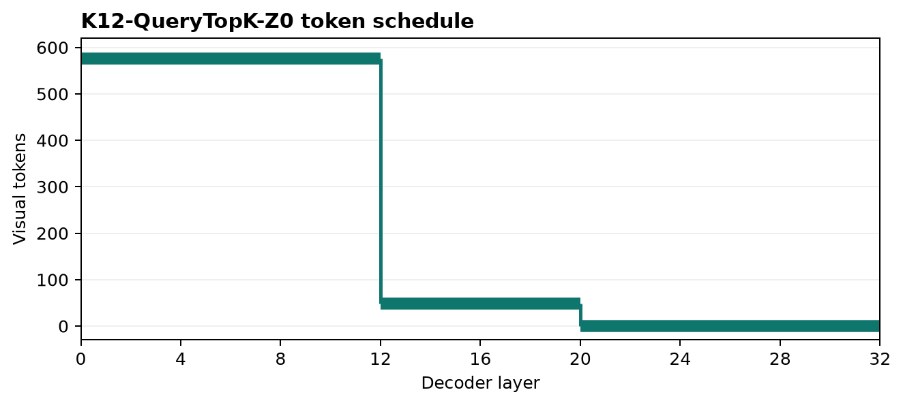
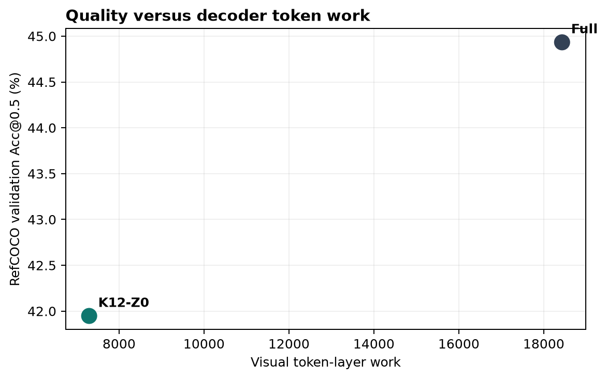
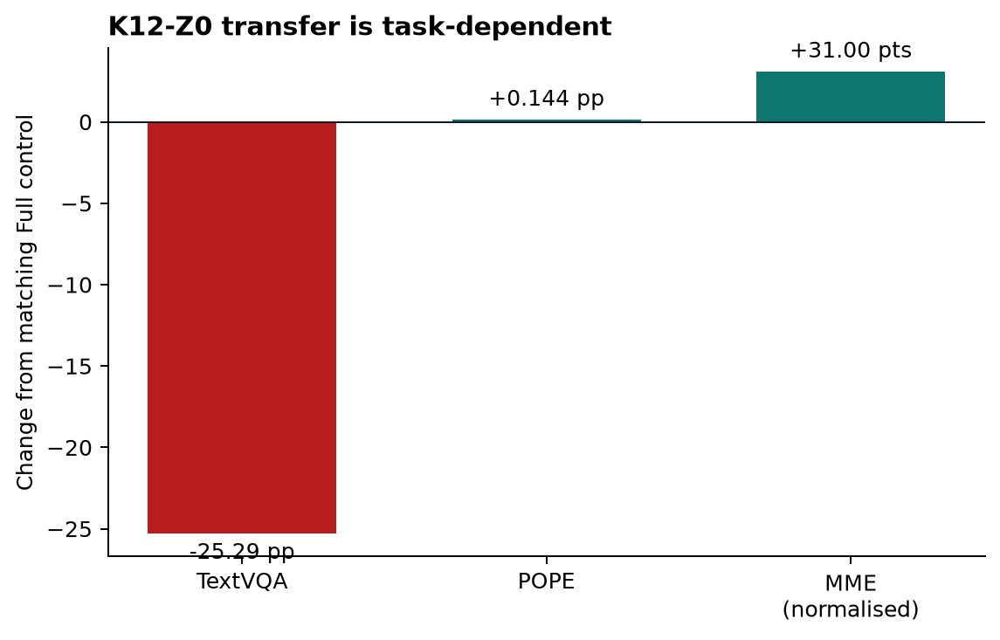
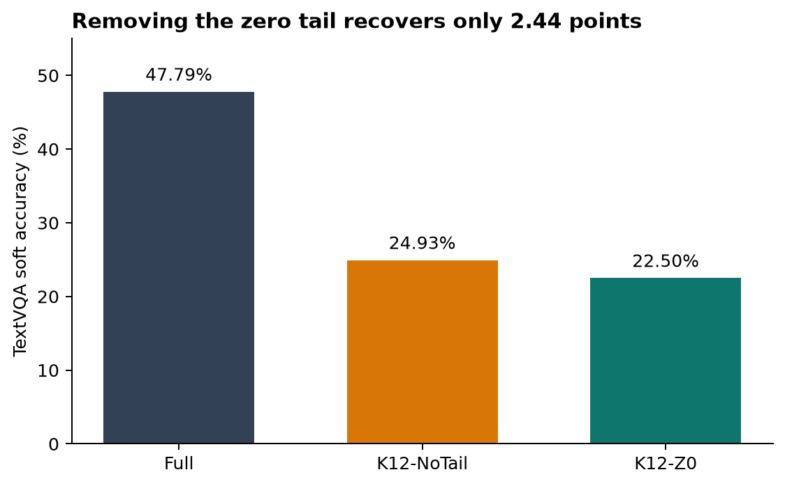

# K12-QueryTopK-Z0: training-free visual-token pruning for LLaVA

This is the cleaned research repository for an MSc dissertation on reducing the number of image
tokens processed by decoder-only vision-language models. It contains the final inference code,
the experiment and verification entrypoints that support the reported results, focused tests, and
a compact machine-readable result bundle.

The final method is **K12-QueryTopK-Z0**. LLaVA-1.5-7B starts with 576 image tokens, keeps the 48
tokens most relevant to the query after decoder layer 12, and removes the remaining visual states
after layer 20. No selector is trained and no test split is used to tune the method.



The schedule is `[576] × 12 + [48] × 8 + [0] × 12`: 7,296 visual token-layers, or 228 visual
tokens per decoder layer on average, compared with 18,432 for Full inference.

## Main results

The method reduces analytical work and measured latency, but it does not preserve quality on every
split or task.

| RefCOCO split | Samples | Full Acc@0.5 | K12-Z0 Acc@0.5 | Change |
|---|---:|---:|---:|---:|
| Validation | 8,811 | 44.93% | 41.95% | -2.98 pp |
| testA | 5,657 | 50.96% | 47.18% | -3.78 pp |
| testB | 5,095 | 39.94% | 37.37% | -2.57 pp |



On an NVIDIA A40, five paired 1,000-example repetitions measured 0.869 seconds per example for
Full and 0.814 seconds for K12-Z0, a **6.26% reduction**. Modelled prefill falls from 8.96 to
4.32 TFLOPs and prompt KV storage falls by 54.04%. Timing is hardware- and implementation-specific.

### Transfer

| Benchmark | Full | K12-Z0 | Paired change (95% CI) |
|---|---:|---:|---:|
| POPE accuracy | 86.18% | 86.32% | +0.144 pp [-0.211, +0.489] |
| MME total | 1,792.04 | 1,823.05 | +31.00 [-15.61, +80.65] |
| TextVQA soft accuracy | 47.79% | 22.50% | -25.292 pp [-26.532, -24.090] |



TextVQA is the clearest limitation. A post-hoc diagnostic retained the 48 selected tokens after
layer 20 and reached 24.93%, recovering only 2.44 percentage points (about 9.64% of the deficit to
Full). The main loss therefore cannot be attributed solely to the final zero-token tail.



### Recent methods

These figures are changes from each method's matching Full control, not a single-stack leaderboard.
FastV, IVC-Prune and Nüwa use their authors' software and, in some cases, different checkpoints or
preprocessing.

| Method | RefCOCO accuracy | Token-work reduction | Latency reduction |
|---|---:|---:|---:|
| K12-Z0 | -2.98 pp | 60.42% | 6.26% |
| FastV | -19.10 pp | 65.45% | 44.43% |
| IVC-Prune | -3.90 pp | 35.72% | 6.77% |
| Nüwa | +3.84 pp | 66.67% | 9.01% |

The FastV quality point uses the registered 1,000-record validation subset. External-method values
should only be interpreted relative to their own Full controls.

## Reproduce and verify

Python 3.11 and the pinned packages in `requirements.txt` reproduce the canonical LLaVA path.
GPU inference requires the registered datasets, manifests, model snapshots, and raw artifact bundle;
these are intentionally not stored in Git. External methods may require their own pinned environment.

```bash
python3.11 -m venv .venv
source .venv/bin/activate
python -m pip install --upgrade pip
python -m pip install -r requirements.txt
```

The controller is dry-run-first. This prints every registered command without starting a GPU job:

```bash
python scripts/reproduce.py
```

Run a stage by name, or add `--execute` to execute it:

```bash
python scripts/reproduce.py main
python scripts/reproduce.py selector
python scripts/reproduce.py timing
python scripts/reproduce.py baselines
python scripts/reproduce.py external
python scripts/reproduce.py main --execute
```

The fastest path is inference-free. It regenerates the README plots and validates the accepted
summary, CSV tables, schedule arithmetic, and displayed headline values:

```bash
python scripts/reproduce.py verify --execute
```

For IVC-Prune, set `IVC_PYTHON`, `IVC_SOURCE`, and `IVC_MODEL_SNAPSHOT` to the pinned environment,
official checkout, and immutable model snapshot before executing the external stage. The worker
enforces official commit `03afd9cee41f60bb30b51a4105839f2b5d467814` and model revision
`a272c74b2481d8aff3aa6fc2c4bf891fe57334fb`.

## Repository layout

| Path | Purpose |
|---|---|
| `vlm_pruning/` | Token selection, progressive pruning, cache handling, scoring, and statistics |
| `scripts/reproduce.py` | Single dry-run-first workflow controller |
| `reproduction.yaml` | Registered commands and stages |
| `scripts/run_progressive_oracle_refcoco.py` | Full, K12, merging, and zero-tail scientific worker |
| `scripts/run_official_baseline.py` | Full, controls, and FastV-compatible worker |
| `scripts/run_native_nuwa_refcoco.py` | Nüwa within-stack worker |
| `scripts/run_ivc_prune_refcoco.py` | IVC-Prune within-stack worker |
| `results/dissertation/` | Compact accepted JSON/CSV evidence |
| `assets/readme/` | Figures generated from the accepted summary |
| `tests/` | Focused scientific and workflow checks |

The numerical source of truth for this repository is
[`results/dissertation/summary.json`](results/dissertation/summary.json). Large raw predictions are
required for a fresh independent rescore and remain in the separately archived experiment bundle.
