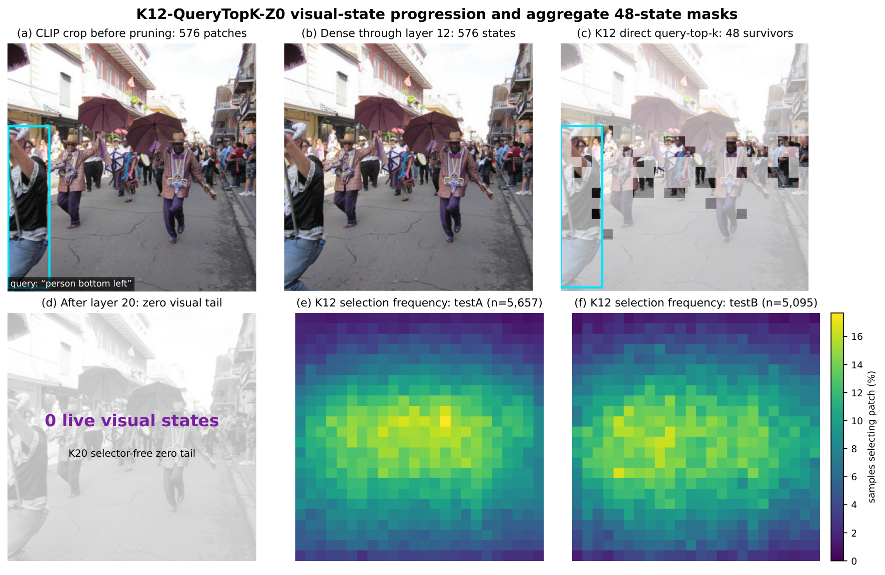
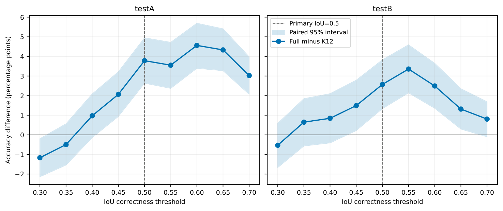
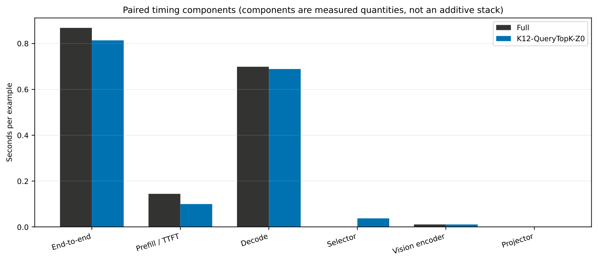
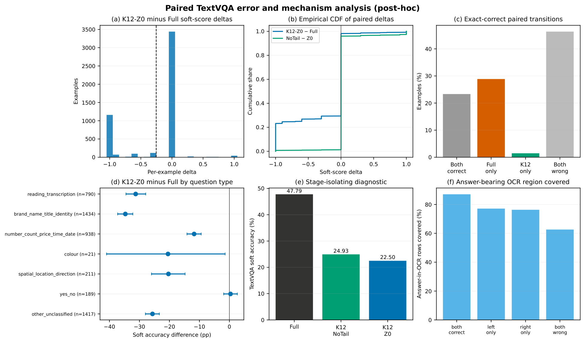
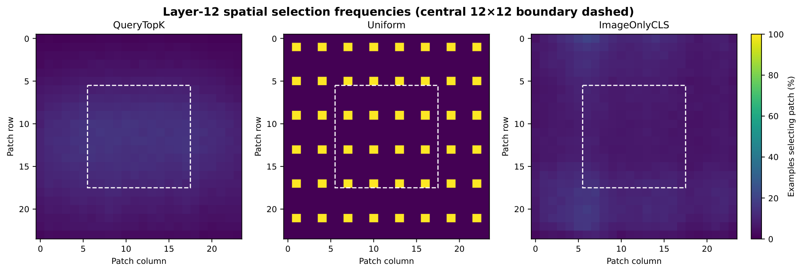

# Training-free visual-token compaction in LLaVA-1.5-7B

LLaVA-1.5-7B represents each image as 576 patch-level tokens and processes them alongside the
user's instruction through 32 decoder layers. This gives the model detailed visual evidence, but
it also increases computation and the size of the key–value (KV) cache used during generation.

This project investigates a simple question: **can some of those visual tokens be removed while
keeping enough information to answer the request accurately?** The main experiments use RefCOCO
visual grounding, where the model must locate an object described by an expression such as “the
person in the red shirt”. This is a demanding test because the model needs both the correct object
and its precise location.

## The final method

The final method is **K12-QueryTopK-Z0**, a fixed, training-free pruning schedule:

1. Process all 576 visual tokens through the first 12 decoder layers.
2. Compare the image-token states with the query and retain the 48 most relevant tokens.
3. Keep those 48 tokens until layer 20, then remove the remaining visual states for the final 12
   layers.


The resulting schedule is `[576] × 12 + [48] × 8 + [0] × 12`. It performs 7,296 units of visual
token-layer work, compared with 18,432 for Full inference—a reduction of 60.42%. The retained
tokens keep their original positional gaps, and a layer-aware cache allows generation to continue
after the sequence has been shortened.

The example below shows what this means for an individual request. The image begins as a dense
24×24 patch grid. At layer 12, the selector keeps 48 patches concentrated around the referred
person and other potentially useful regions. After layer 20, the decoder continues using the
visual information already mixed into the text states, with no live visual states remaining.



The method does not use a learned selector or adapt its budget to individual examples. Its
configuration was chosen using RefCOCO validation and then evaluated without further tuning on
the held-out splits and transfer benchmarks.

## What the experiments found

The main result is a trade-off rather than a universal improvement. K12-Z0 substantially reduces
analytical work, memory use and measured latency, but it also loses grounding accuracy. The size
of that loss varies across RefCOCO splits and becomes much larger on a task that depends on reading
text in images.

### RefCOCO grounding

| Split | Examples | Full Acc@0.5 | K12-Z0 Acc@0.5 | Change |
|---|---:|---:|---:|---:|
| Validation | 8,811 | 44.93% | 41.95% | -2.98 pp |
| testA | 5,657 | 50.96% | 47.18% | -3.78 pp |
| testB | 5,095 | 39.94% | 37.37% | -2.57 pp |

Acc@0.5 counts a prediction as correct when its bounding box overlaps the reference box by at
least 50%. Accuracy falls on both held-out splits, with the larger reduction on testA. K12-Z0 is
therefore an efficient operating point, but the results do not support a claim that grounding
quality is fully preserved.

This conclusion is not specific to the main 0.5 overlap threshold. The threshold analysis below
shows Full minus K12-Z0 accuracy at several levels of localisation strictness. Positive values
favour Full; the shaded regions are paired 95% confidence intervals.




### Practical efficiency

Five paired timing repetitions were run on the same 1,000 RefCOCO examples using an NVIDIA A40.
Full inference took 0.869 seconds per example and K12-Z0 took 0.814 seconds, giving a **6.26%
end-to-end speed-up**. Prompt KV storage fell by 54.04%, while modelled prefill computation fell
from 8.96 to 4.32 TFLOPs.

The runtime improvement is useful but much smaller than the 60.42% reduction in visual
token-layer work. The early decoder layers remain dense, and image encoding, query scoring,
selection, cache handling and answer generation still take time. Token counts and theoretical
computation should therefore not be treated as direct measurements of speed.



The component bars are measured quantities rather than parts of an additive stack. In particular,
the selector adds work of its own, while decoding remains the largest part of the request.

### Transfer to other tasks

The same frozen K12-Z0 schedule was evaluated on POPE, MME and TextVQA.

| Benchmark | Full | K12-Z0 | Paired change (95% CI) |
|---|---:|---:|---:|
| POPE accuracy | 86.18% | 86.32% | +0.144 pp [-0.211, +0.489] |
| MME total | 1,792.04 | 1,823.05 | +31.00 [-15.61, +80.65] |
| TextVQA soft accuracy | 47.79% | 22.50% | -25.292 pp [-26.532, -24.090] |


POPE and MME remain close to their matching Full results, and both confidence intervals include
zero. TextVQA is very different: soft accuracy falls by more than 25 percentage points. A fixed
48-token representation that works reasonably well for object grounding does not retain enough
information for reliable text reading.

To examine whether the final removal at layer 20 caused this failure, a post-hoc NoTail diagnostic
kept the same 48 tokens through the remaining layers. Accuracy rose from 22.50% to 24.93%, a
recovery of 2.44 points, but most of the deficit remained. The TextVQA loss is therefore not mainly
explained by the zero-token tail; it is more closely associated with the shared layer-12,
48-token representation. This diagnostic does not separate the effects of pruning depth, token
budget and query-top-k ranking.


<details>
<summary>Detailed TextVQA error and mechanism analysis</summary>

The dissertation also examines per-example score changes, correctness transitions, question
types and coverage of answer-bearing OCR regions. These are descriptive post-hoc patterns, not a
causal explanation of the loss.



</details>

## What the design comparisons showed

The development experiments varied pruning depth, token budget, selection rule, merging and late
visual-token removal. Three findings shaped the final design:

- Earlier pruning saves more work but risks removing evidence before the image and query states
  have interacted sufficiently.
- Direct query-top-k selection performs better than fixed spatial sampling and image-only salience
  at the same K12-Z0 workload. A structured target/context/anchor selector does not reliably
  improve on the simpler rule.
- Merging discarded tokens can preserve some information, but its measured advantage over hard
  deletion is small and uncertain. It also introduces additional implementation overhead.

The spatial frequency maps illustrate why selector choice matters. Uniform sampling always keeps
the same grid. Image-only salience and query-top-k vary with the image, but query-top-k can use the
referring expression when deciding which patches matter.



Recent pruning methods were evaluated in their compatible software environments. The table below
reports each method relative to Full inference in the **same stack**; the raw values are not a
single controlled leaderboard.

| Method | RefCOCO accuracy change | Token-work reduction | Latency reduction |
|---|---:|---:|---:|
| K12-Z0 | -2.98 pp | 60.42% | 6.26% |
| FastV | -19.10 pp | 65.45% | 44.43% |
| IVC-Prune | -3.90 pp | 35.72% | 6.77% |
| Nüwa | +3.84 pp | 66.67% | 9.01% |

FastV's quality result uses the registered 1,000-example validation subset. IVC-Prune and Nüwa
use their authors' implementations, and Nüwa also uses its compatible checkpoint and preprocessing.
These comparisons provide context for the observed trade-offs rather than a cross-stack ranking.

## Reproducing the results

The canonical LLaVA experiments use Python 3.11 and the versions pinned in `requirements.txt`.

```bash
python3.11 -m venv .venv
source .venv/bin/activate
python -m pip install --upgrade pip
python -m pip install -r requirements.txt
```

The reproduction controller is dry-run-first. Running it without `--execute` prints the complete
plan without starting GPU inference:

```bash
python scripts/reproduce.py
```

Individual stages can be inspected or executed separately:

```bash
python scripts/reproduce.py main
python scripts/reproduce.py selector
python scripts/reproduce.py timing
python scripts/reproduce.py baselines
python scripts/reproduce.py external

# Add --execute when the required data, checkpoints and GPU are available.
python scripts/reproduce.py main --execute
```

Datasets, model snapshots and full prediction files are not stored in Git. A complete inference
rerun requires the registered external artifact bundle and the paths checked by each worker. The
compact accepted results can be verified without model inference:

```bash
python scripts/reproduce.py verify --execute
```

This command regenerates the summary plots and checks every README figure, the summary values, CSV
tables, schedule arithmetic and locally available source hashes. The numerical source of truth is
[`results/dissertation/summary.json`](results/dissertation/summary.json), with provenance recorded
in [`results/dissertation/provenance.json`](results/dissertation/provenance.json).

IVC-Prune uses a separate pinned environment. Before executing that stage, set `IVC_PYTHON`,
`IVC_SOURCE` and `IVC_MODEL_SNAPSHOT` to its Python interpreter, official checkout and immutable
model snapshot. The registered source commit is
`03afd9cee41f60bb30b51a4105839f2b5d467814`, and the model revision is
`a272c74b2481d8aff3aa6fc2c4bf891fe57334fb`.

## Code guide

| Path | Purpose |
|---|---|
| `vlm_pruning/` | Selection, progressive pruning, position handling, cache execution and scoring |
| `scripts/reproduce.py` | Dry-run-first reproduction controller |
| `reproduction.yaml` | Registered experiment stages and commands |
| `scripts/run_progressive_oracle_refcoco.py` | K12, merging and zero-tail inference |
| `scripts/run_official_baseline.py` | Full inference, controls and FastV |
| `scripts/run_native_nuwa_refcoco.py` | Nüwa within-stack evaluation |
| `scripts/run_ivc_prune_refcoco.py` | IVC-Prune within-stack evaluation |
| `results/dissertation/` | Compact accepted results and provenance |
| `tests/` | Scientific and workflow checks |

The broader conclusion is that shortening the visual sequence is only an intermediate mechanism.
A useful pruning method must produce measured acceleration and must also be tested on the kinds of
visual evidence required by its intended task.
